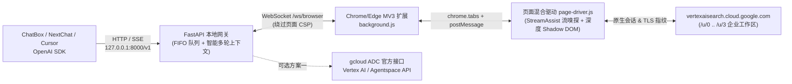

# Gemini Enterprise Web-to-API Bridge

将已登录的 **Google Cloud Gemini Enterprise（Vertex AI Search / Agentspace，`vertexaisearch.cloud.google.com`）** 安全、稳定地包装为标准本地 **OpenAI 兼容接口（`/v1/chat/completions` & `/v1/models`）**，无缝接入 **ChatBox、NextChat、Cursor、Cherry Studio、Open WebUI** 及 OpenAI Python/JS SDK。

> **⚠️ 免责声明 (Unofficial / Disclaimer)**：本项目为非官方开源技术研究与个人本地开发工具桥接方案，与 Google LLC / Google Cloud 无任何隶属、合作或官方背书关系。使用者须严格遵守所在企业/机构的 IT 安全与数据合规制度以及 Google 服务条款（Terms of Service）。如拥有企业 GCP 项目 IAM 权限，建议优先启用内置的 **方案一（GCloud 官方 ADC 模式）**。
>
> **🔒 安全建议 (Security Note)**：请务必在 `.env` 中保持 `BRIDGE_HOST=127.0.0.1`（仅限本机回环访问，切勿暴露至公网或 `0.0.0.0`），并强烈建议配置非空的强随机 `BRIDGE_API_KEY`（如 `BRIDGE_API_KEY=sk-your-private-random-key`），防止本机其他未授权进程调用本地代理接口。本项目全程**绝不提取、硬编码或落盘任何 Google 账号 Cookie / Token**。

---

## 为什么采用「MV3 浏览器扩展 + 混合驱动 + FastAPI」架构？

直接抓包提取企业账号 Cookie 或使用普通 `@grant none` 油猴脚本在 `vertexaisearch.cloud.google.com/u/3/...` 企业工作区会遇到三大阻碍，本项目逐一给出了工程级解决：

| 痛点 | 传统脚本/纯逆向的问题 | 本项目的解决方案 |
|---|---|---|
| **CSP 与私有网络拦截 (PNA)** | 企业页 `Content-Security-Policy (connect-src)` 直接拦截页面内 `new WebSocket("ws://127.0.0.1:8000")` | **主方案**：Manifest V3 扩展由后台 Service Worker 维持 WebSocket，天然绕过页面 CSP；**备选油猴**：采用 `GM_xmlhttpRequest` 特权通道长轮询，同样 100% 免疫 CSP |
| **多层嵌套 Shadow DOM + 动态签名** | Google 企业端基于 Lit / Angular Web Components（`ucs-standalone-app` / `ucs-chat` / `ProseMirror`），且内部 RPC 含动态 `SAPISIDHASH` 与 `at` 令牌 | **混合页面驱动 (`page-driver.js`)**：被动嗅探页面原生 `StreamAssist` 网络流实现毫秒级流式输出与企业引用提取，同时配备深度 Shadow DOM 穿透自动输入与增量稳定性检测，**第一条消息即可开箱即用**，完全复用真实浏览器 TLS 指纹与登录态 |
| **第三方客户端兼容性与并发冲突** | Cursor / NextChat 发送数组型 `content`、多轮完整历史及并发请求会导致普通脚本 `422` 报错或网页输入框串台 | **完整 OpenAI 网关 (`server.py`)**：原生支持 `stream: true` (SSE) 与非流式、字符串与多模态数组 `content`、**智能多轮增量上下文 (`smart` delta)** 以及 **异步 FIFO 互斥队列** |



---

## 3 分钟快速上手（Windows 一键启动）

### 第一步：启动本地 FastAPI 代理网关

双击运行 `start.bat`，或在 PowerShell 中执行：

```powershell
cd I:\Projects\Gemini-Enterprise-Bridge
.\start.ps1
```

脚本会自动：
1. 在 `%LOCALAPPDATA%\Gemini-Enterprise-Bridge\venv` 创建独立虚拟环境并安装依赖（保持项目目录纯净）；
2. 自动生成默认 `.env` 配置文件；
3. 自动导出带高清图标的独立扩展目录 `I:\Projects\Gemini-Enterprise-Bridge\extension`；
4. 启动本地服务 `http://127.0.0.1:8000`。

> 若希望直接使用现有 Python 环境手动启动：
> ```powershell
> pip install -r requirements.txt
> python server.py
> ```

### 第二步：在 Chrome 或 Edge 加载浏览器扩展（推荐主方案）

1. 打开浏览器访问 `chrome://extensions/`（Edge 访问 `edge://extensions/`）；
2. 开启右上角 **开发者模式 (Developer mode)**；
3. 点击 **加载已解压的扩展程序 (Load unpacked)**，选择目录：
   - 推荐选择启动后自动生成的 `I:\Projects\Gemini-Enterprise-Bridge\extension`（含 `16/48/128` 图标）；
   - 或直接选择项目根目录 `I:\Projects\Gemini-Enterprise-Bridge`（同样符合 Manifest V3，立即可用）。
4. 在同一浏览器中打开并登录你的 Gemini Enterprise 页面（例如 `https://vertexaisearch.cloud.google.com/u/3/home`），进入任意对话页或工作区主页。
5. 查看浏览器右上角扩展图标角标变为绿色的 **`ON`**（也可点击图标打开弹窗，点击 **检测页面元素** 验证输入框与连接状态，或访问 `http://127.0.0.1:8000/` 在线流式测试）。

> **备选方案（Tampermonkey 油猴脚本）**：若不想加载未打包扩展，可在 Tampermonkey 中新建脚本并粘贴 `gemini-enterprise-bridge.user.js`（启动后亦同步生成于 `userscript/`）。该脚本通过 `GM_xmlhttpRequest` 与本地网关通信，不会触发页面 CSP 报错（注意：请勿在同一标签页同时启用扩展与油猴脚本；若检测到扩展已激活，油猴脚本会自动让出控制权）。

### 第三步：接入 ChatBox / NextChat / Cursor

在任意支持自定义 OpenAI 接口的客户端中填入以下参数：

| 配置项 | 填写值 |
|---|---|
| **API Host / Base URL** | `http://127.0.0.1:8000/v1` |
| **API Key** | 任意非空字符串（如 `sk-local-bridge`；若在 `.env` 设置了 `BRIDGE_API_KEY` 则填对应值） |
| **Model（保持网页当前模型）** | `gemini-enterprise-web`（新建对话：`gemini-enterprise-web-newchat`） |
| **Model（自动切换 Gemini 3.1 Pro）** | `gemini-3.1-pro`（简写：`3.1pro` / `3.1-pro`；新建对话：`gemini-3.1-pro-newchat`） |
| **Model（自动切换 Gemini 4 Argon）** | `gemini-4-argon`（简写：`4argon` / `4-argon`；新建对话：`gemini-4-argon-newchat`） |
| **Model（自动切换 Gemini 3.8 Flash）** | `gemini-3.8-flash`（简写：`3.8flash` / `3.8-flash`；新建对话：`gemini-3.8-flash-newchat`） |
| **Model（其他网页模型透传）** | `gemini-2.5-pro`、`gemini-2.5-flash` 或任意 `gemini-web:<网页菜单名称>` |
| **Model（官方 GCloud 模式）** | `gemini-enterprise-gcloud` |

> **提示**：网关同时兼容将 Base URL 填为 `http://127.0.0.1:8000` 或 `http://127.0.0.1:8000/v1`。在 Custom Endpoint 客户端中拉取模型列表（`GET /v1/models`）即可直接下拉选择上述全部模型！

---

## 核心特性说明

### 1. 客户端直接切换网页模型（3.1 Pro / 4 Argon / 3.8 Flash）
无需切回浏览器手动点选模型菜单：在 Cursor、Cline、ChatBox、NextChat 或代码中指定 `model`（例如 `gemini-3.1-pro`、`4argon`、`3.8flash`），页面混合驱动会自动穿透多层 Shadow DOM 检查当前激活模型；若与目标不一致，则自动打开模型下拉框完成切换后再发送请求（若企业管理员锁定了单模型，也会自动记录提示并平滑降级发送，绝不中断请求）。

### 2. 完整 OpenAI Tool Calling (`tools` / `tool_calls`) 与多轮 Agentic Loop 支持
完美适配 **Cursor Agent、Cline、Roo Code、LangChain、OpenAI Agents SDK** 等智能体工具循环：
- **DOM 免疫型工具协议**：采用纯文本边界标记 `[TOOL_CALL]{"name": "...", "arguments": {...}}[/TOOL_CALL]`（同时兼容 `<tool_call>`、```` ```tool_call ```` 与强制函数 JSON 兜底解析），确保无论是原生 `StreamAssist` 流嗅探还是网页 Markdown DOM 渲染提取，工具调用参数均 100% 无损还原。
- **流式 SSE 零泄漏缓冲 (`ToolStreamProcessor`)**：在 `stream: true` 模式下实时流式输出助手思考/前言文本，自动拦截工具标记并转换为标准 OpenAI `delta.tool_calls` 分片与 `finish_reason: "tool_calls"`，绝不向客户端正文泄漏原始标签。
- **同会话增量 Agentic Loop (`smart_incremental_delta`)**：在多步工具调用循环（含单工具、并行多工具调用 `parallel_tool_calls`、连续多轮 `tool` 结果回传）中自动匹配历史前缀，保持 `reset_chat=false` 在同一网页对话内增量投递 `[TOOL_RESULT]`，且不重复刷入冗长的工具 JSON Schema。
- **100KB+ 超长上下文与大参数无损分块 + 异步 HTTP 回调 (`/api/bridge/callback`)**：
  - 下行超长工具 Schema / `[TOOL_RESULT]`（`>32KB`）自动拆分为 `execute_prompt_chunk` 经 `content-bridge.js` 的 `ReassemblyBuffer` 无损重组，并通过单次 `DocumentFragment.replaceChildren()` 高速写入编辑器；
  - 上行超长回复或大体积 `write_file` 工具调用自动通过 `POST /api/bridge/callback` 异步直传服务端，且 SSE 流式输出自动按 `<=12KB` 安全切片推送 `delta.tool_calls` 参数片段，彻底规避 WebSocket 帧上限与 64KB SSE 行缓冲截断。
- **后台静默执行与 Google Cloud `Trusted Types` 安全合规**：
  - 消除后台标签页永久挂起的 `requestAnimationFrame` 依赖，采用 `MessageChannel` + MV3 Service Worker 非降频计时器 (`GEB_SW_SLEEP`) + `autoDiscardable: false` 防休眠保护，支持 Chrome 置于后台或最小化时静默收发；
  - 全仓零 `.innerHTML` 赋值，100% 兼容 Google Cloud 强制 `Trusted Types` (`require-trusted-types-for 'script'`) 安全策略。
- **结构化 JSON 输出 (`response_format`)**：支持 `{"type": "json_object"}` 与 `json_schema`，自动剥离网页端多余的 Markdown 代码块围栏并抑制参考链接尾注。

```python
from openai import OpenAI

client = OpenAI(base_url="http://127.0.0.1:8000/v1", api_key="sk-local-bridge")

resp = client.chat.completions.create(
    model="gemini-4-argon",  # 或 "gemini-3.1-pro" / "gemini-3.8-flash"
    messages=[{"role": "user", "content": "查询香港天气并检索差旅政策"}],
    tools=[
        {
            "type": "function",
            "function": {
                "name": "get_weather",
                "description": "获取城市实时天气",
                "parameters": {
                    "type": "object",
                    "properties": {"city": {"type": "string"}},
                    "required": ["city"],
                },
            },
        }
    ],
)
print(resp.choices[0].message.tool_calls)
```

### 3. 多账号 `/u/3/` 标签页定向绑定
如果你在浏览器中同时登录了个人 Google 账号（`/u/0/`）与企业/机构账号（`/u/3/`），点击扩展弹窗即可在 **绑定标签页** 下拉框中精确指定某个标签页，或交由扩展自动选择活跃的 Gemini Enterprise 页面。

### 4. 三种页面执行模式（扩展弹窗可随时切换）
- **`Auto 混合模式`（默认推荐）**：通过深层 Shadow DOM 自动填入问题并触发发送，同时在 `MAIN` 世界被动监听 `StreamAssist` / `converse` 响应流，实时推送流式文本分片与企业知识库参考链接；若接口格式变动，自动无缝回退至 Shadow DOM 增量文本提取。
- **`DOM 纯组件模式`**：仅依赖网页 DOM 渲染增量与生成完成状态判定，兼容性最强。
- **`Replay 页面内重放模式`**：在网页正常产生过 1 次对话请求后，直接复用页面上下文内的 `fetch` 模板替换 `query.text` 重放请求。

### 5. 智能多轮对话与本地会话自动隔离 (`BRIDGE_CONTEXT_MODE` & `BRIDGE_AUTO_RESET_NEW_CHAT`)
- **`smart` + `BRIDGE_AUTO_RESET_NEW_CHAT=true`（默认开启）**：
  - **本地新建会话 -> 网页自动新建会话**：当你在 ChatBox / NextChat / Cursor 中点击新建对话发送第 1 条消息时（无需手动改选 `-newchat` 模型名），网关会自动识别并触发网页端开启全新会话（若网页本身已在空白新会话页则 0ms 秒级跳过）。
  - **同一本地会话多轮追问 / Agentic Loop -> 增量续聊 (`reset_chat=False`)**：同一会话内的第 2..N 轮提问或工具调用结果回传，网关严格保持在同一网页会话内**仅发送最新增量内容**，完整保留上下文与企业连接器。
  - **切换本地历史会话 -> 自动开新网页会话并打包上下文**：在客户端侧边栏切回另一条旧会话继续提问时，自动开启干净网页会话并注入该会话历史，彻底杜绝不同本地会话串台。
- 如希望始终在当前打开的固定网页对话中追加而不自动重置，可在 `.env` 中设 `BRIDGE_AUTO_RESET_NEW_CHAT=false`（此时仍可通过 `*-newchat` 模型名或 `[NEW_CHAT]` 前缀按需新建）。

### 6. 可选方案一：官方 Google Cloud CLI (`gcloud`) 模式
若后续获得 GCP 项目访问权限，无需修改客户端配置：
1. 安装 Google Cloud SDK 并执行：`gcloud auth application-default login`
2. 在 `.env` 中设置 `GCP_PROJECT_ID=你的项目ID`（如需直连 Agentspace 引擎可额外填写 `GCP_ENGINE_ID`）
3. 将 `BRIDGE_BACKEND_MODE` 设为 `gcloud`（或 `auto`），或在客户端模型名中选择 `gemini-enterprise-gcloud`。

---

## 运行自动化测试

```powershell
.\start.ps1 -Test
# 或直接使用 pytest：
pytest -v
```

测试套件 (`test_bridge.py`) 完整覆盖：
- `/health`、`/api/status`、`/v1/models` 与 API Key 鉴权校验；
- 网页模型直选与简写别名解析（`3.1pro`、`4argon`、`3.8flash`、`*-newchat`、`gemini-web:*`）及向浏览器端下发验证；
- OpenAI Tool Calling 非流式与 SSE 流式分片解析（含并行工具控制、强制函数调用、零标签泄漏验证）；
- 多轮 Agentic Loop 同会话增量回传（`smart_incremental_delta` + `reset_chat=False`）与 `json_object` 模式校验；
- 模拟浏览器 WebSocket 扩展与 Tampermonkey HTTP 长轮询桥接及并发请求 FIFO 串行锁验证；
- 纯 Python 动态生成的 `16x16` / `48x48` / `128x128` PNG 图标尺寸与 `extension/` 打包校验。

---

## 目录结构

```text
I:\Projects\Gemini-Enterprise-Bridge\
├── server.py                         # FastAPI 主入口（支持 python server.py 直接运行）
├── config.py                         # 环境变量与 .env 配置加载
├── schemas.py                        # OpenAI 兼容模型、工具参数与网页模型别名解析器
├── tool_calling.py                   # DOM 免疫工具调用协议、多级容错解析与 SSE 流式拦截器
├── context_builder.py                # 多轮对话与 Agentic Loop 智能增量上下文构建器
├── bridge_hub.py                     # WebSocket + HTTP 双通道桥接中心与 FIFO 队列锁
├── gcloud_provider.py                # 方案一：官方 GCloud CLI / Vertex AI & Agentspace 上游
├── dashboard_html.py                 # http://127.0.0.1:8000/ 本地可视化控制台与模型测试台
├── extension_exporter.py             # 纯标准库 PNG 图标渲染与独立 extension/ 导出器
├── manifest.json                     # Chrome/Edge Manifest V3 扩展清单（最小权限集）
├── background.js                     # MV3 Service Worker（持久化存储 + 自动重连 WebSocket）
├── content-bridge.js                 # ISOLATED 世界安全消息中继
├── page-driver.js                    # MAIN 世界混合驱动（自动模型切换 + 流嗅探 + 深度 Shadow DOM）
├── popup.html / popup.css / popup.js # 扩展可视化状态弹窗、标签页绑定与页面元素诊断
├── gemini-enterprise-bridge.user.js  # CSP 免疫版 Tampermonkey 油猴备选脚本（含自动模型切换）
├── test_bridge.py                    # Pytest 自动化端到端测试套件
├── requirements.txt / pyproject.toml # Python 依赖声明
├── env.example                       # 环境变量配置模板
├── start.ps1 / start.bat             # Windows 一键初始化、测试与启动脚本
└── CHROMEWEBSTORE.md                 # 扩展权限说明与隐私披露文档
```

---

## 常见问题排查 (Troubleshooting)

1. **客户端提示 `503 未检测到挂载的 Gemini Enterprise 浏览器页面`**：
   - 请确认本地已启动 `start.bat` / `python server.py`；
   - 确认 Chrome/Edge 已加载扩展且已打开 `https://vertexaisearch.cloud.google.com/...` 页面；
   - 点击扩展图标 -> **保存并重连**，或访问 `http://127.0.0.1:8000/` 查看实时连接状态。
2. **网页改版导致找不到输入框或回复容器**：
   - 在 Gemini Enterprise 页面点击扩展弹窗中的 **检测页面元素** 查看自动识别结果；
   - 若企业定制版更换了标签名，可在弹窗 **高级：自定义 Shadow DOM 选择器** 中填入对应的 CSS 选择器（驱动会自动穿透所有层级的 Shadow Root 查找该选择器），无需修改代码即可热更新。
